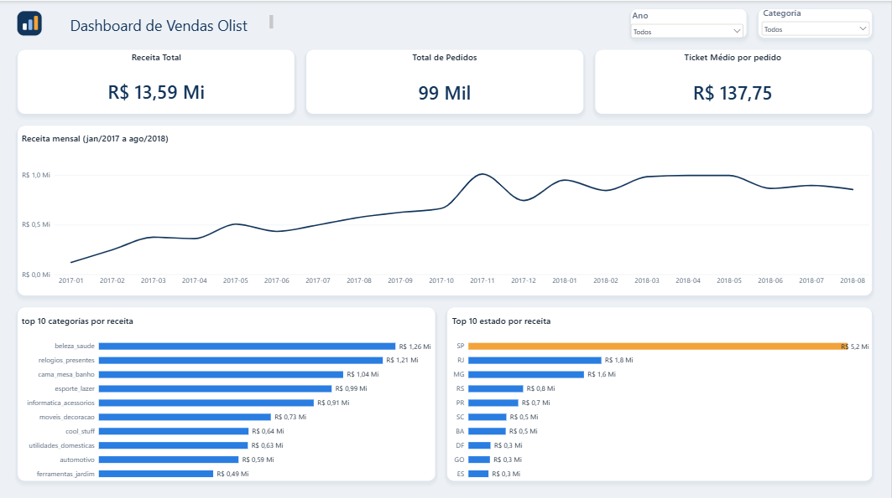

# Análise de Vendas Olist

Análise de dados de e-commerce com **SQL** e **Power BI**, usando dados reais do marketplace brasileiro Olist. O objetivo é responder perguntas de negócio sobre receita, categorias e distribuição geográfica das vendas.



## Fonte dos dados

Dataset público [Brazilian E-Commerce Public Dataset by Olist](https://www.kaggle.com/datasets/olistbr/brazilian-ecommerce), disponível no Kaggle. Os arquivos CSV não estão neste repositório por causa do tamanho; baixe-os pelo link acima.

## Ferramentas

- SQLite e DB Browser for SQLite (consultas e exploração)
- Power BI (modelagem, medidas DAX e dashboard)
- Git e GitHub (versionamento)

## Perguntas respondidas

1. Quantos pedidos existem por status?
2. Qual foi a receita total?
3. Quantos produtos diferentes foram vendidos?
4. Qual o preço médio por item?
5. Quais categorias têm mais produtos cadastrados?
6. Quais categorias geram mais receita?
7. Como os pedidos se distribuem ao longo dos meses?

As consultas estão em [`sql/consultas_basicas.sql`](sql/consultas_basicas.sql).

## Principais resultados

- A receita total foi de aproximadamente **R$ 13,59 milhões**, com cerca de **99 mil pedidos** e ticket médio de **R$ 137,75 por pedido**.
- Foram vendidos **32.951 produtos diferentes**, com preço médio de **R$ 120,65 por item**.
- **Ter mais produtos não significa faturar mais.** `cama_mesa_banho` é a categoria com mais produtos cadastrados (3.029), mas fica em 3º lugar em receita. `beleza_saude` lidera em receita (R$ 1,26 mi), seguida de `relogios_presentes` (R$ 1,21 mi), que tem relativamente poucos produtos e sugere itens de maior valor.
- **São Paulo concentra as vendas:** cerca de R$ 5,2 milhões (aproximadamente 38% da receita total), bem à frente de RJ (R$ 1,8 mi) e MG (R$ 1,6 mi).
- **Crescimento em 2017:** a receita mensal passou de cerca de R$ 0,1 mi em janeiro para perto de R$ 1,0 mi em novembro de 2017, o pico da série, possivelmente influenciado pela Black Friday. Em 2018, as vendas se estabilizaram em torno de R$ 0,85 a R$ 1,0 mi por mês.

## Cuidados com a qualidade dos dados

- Os dados de **2016** são muito escassos e irregulares (4 pedidos em setembro, 324 em outubro, nenhum em novembro e 1 em dezembro). **Setembro de 2018** está incompleto. Por isso, a análise de tendência considera apenas de **janeiro de 2017 a agosto de 2018**.
- No Power BI, as colunas numéricas foram importadas com a localidade **Inglês (EUA)** para evitar erro de separador decimal, que multiplicava a receita por 100. Os valores foram conferidos com os resultados do SQL.

## Limitações

- A receita inclui pedidos **cancelados e indisponíveis**, porque a soma considera todos os itens vendidos.
- Os cartões de KPI consideram todo o período do dataset, enquanto o gráfico mensal mostra só jan/2017 a ago/2018.

## Estrutura do projeto

```
analise-vendas-olist/
├── sql/        consultas SQL da análise
├── powerbi/    arquivo do dashboard (.pbix)
├── imagens/    prints do dashboard
└── README.md
```

## Próximos passos

- Filtrar a análise para pedidos entregues (`order_status = 'delivered'`)
- Analisar prazo de entrega e avaliações dos clientes
- Praticar consultas com CTEs e funções de janela
- Refazer a análise com Python (Pandas)

## Autor

**Lincoln Silva** | [LinkedIn](https://www.linkedin.com/in/lincoln-silva-02a243447) | [GitHub](https://github.com/slincolnsantos)
